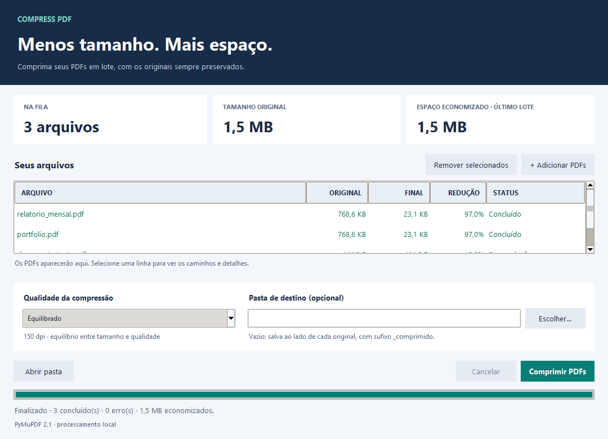

# Compress PDF

Compressor de PDFs com interface desktop em português e linha de comando. Usa o PyMuPDF para reduzir arquivos e mostra o tamanho antes e depois, sem alterar os originais.



## Recursos

- Seleção de vários PDFs e processamento em lote.
- Três perfis com redução de imagens e um perfil para preservar a qualidade visual.
- Pasta de destino opcional; por padrão, salva ao lado de cada original.
- Fila com status por arquivo, progresso por quantidade de PDFs e espaço economizado.
- Processamento em segundo plano, com cancelamento e janela responsiva.
- Nomes de saída automáticos: `arquivo_comprimido.pdf`, `arquivo_comprimido_2.pdf`, etc.
- Se não houver redução, a saída será uma cópia do original, com status **Sem redução**.
- Arquivos temporários removidos em caso de erro, cancelamento ou tempo limite.
- Compressão com PyMuPDF, instalado pelo pip.
- Uso pelo terminal preservado.

## Requisitos e instalação

- Python 3.11 ou superior com Tkinter.
- [PyMuPDF](https://pymupdf.readthedocs.io/en/latest/installation.html), conforme `requirements.txt`.

Na pasta do projeto, use o mesmo Python que vai executar o aplicativo:

```bash
python -m pip install -r requirements.txt
```

A compressão usa a biblioteca PyMuPDF. Não é necessário configurar executáveis externos no PATH.

No Windows, a instalação usual do Python inclui Tkinter. No Debian/Ubuntu, caso necessário:

```bash
sudo apt-get install python3-tk
```

No macOS, utilize uma distribuição do Python com suporte a Tkinter.

## Interface desktop

Na pasta do projeto:

```bash
python compress_pdf.py
```

Também é possível usar `python compress_pdf.py --gui` ou `python pdf_gui.py`.

1. Clique em **Adicionar PDFs** e selecione um ou mais documentos.
2. Escolha o perfil de qualidade.
3. Opcionalmente, escolha uma pasta de destino existente.
4. Clique em **Comprimir PDFs**.
5. Consulte o tamanho final e a redução na tabela. Selecione uma linha para ver os caminhos ou detalhes de erros.
6. Use **Abrir pasta** para acessar a pasta do último resultado concluído.

Os documentos são processados um de cada vez para limitar o uso de recursos. A barra avança a cada arquivo finalizado; ela não representa páginas ou uma estimativa de tempo. Um erro em um PDF não interrompe os demais. O cancelamento interrompe o arquivo ativo e mantém os resultados já concluídos.

## Linha de comando

```bash
python compress_pdf.py entrada.pdf saida.pdf
python compress_pdf.py entrada.pdf saida.pdf -p screen
python compress_pdf.py "meus arquivos/original.pdf" "meus arquivos/saida.pdf" -p printer
```

Saídas existentes são protegidas. Para substituí-las explicitamente:

```bash
python compress_pdf.py entrada.pdf saida.pdf --force
```

O caminho de saída deve ser diferente do original, mesmo com `--force`. A pasta de destino precisa existir.

O tempo limite padrão é de 300 segundos por PDF, inclusive na interface. Pelo terminal, ele pode ser ajustado:

```bash
python compress_pdf.py entrada.pdf saida.pdf --timeout 600
```

Use `python compress_pdf.py --help` para consultar as opções. O comando retorna código 0 em caso de sucesso, 1 em erros de processamento e 2 em argumentos inválidos.

## Perfis de qualidade

| Perfil | Interface | DPI alvo | Qualidade JPEG |
|---|---|---|---|
| `screen` | Máxima compressão | 72 | 50 |
| `ebook` | Equilibrado (padrão) | 150 | 75 |
| `printer` | Alta qualidade | 300 | 90 |
| `prepress` | Preservar qualidade | Mantém a resolução original | Sem recompressão com perda |

Os nomes dos perfis no terminal foram mantidos para compatibilidade com os comandos anteriores. Os parâmetros agora são definidos pelo projeto para o PyMuPDF.

Os três primeiros perfis recomprimem imagens coloridas e em tons de cinza. A resolução só é reduzida quando ultrapassa 1,5 vez o DPI alvo; imagens menores não são ampliadas. Imagens monocromáticas não passam por essa recompressão. O texto e os desenhos vetoriais continuam no PDF, sem converter páginas inteiras em imagens.

O perfil **Preservar qualidade** otimiza a estrutura do documento e comprime dados sem reduzir a qualidade das imagens. Todos os perfis removem objetos não utilizados, combinam objetos duplicados e comprimem streams.

A redução depende do conteúdo e da compressão existente. Os três perfis com JPEG podem alterar a aparência das imagens; confira o resultado antes de distribuir. Salvar uma nova versão pode invalidar assinaturas digitais. Os originais ficam preservados. PDFs que exigem senha são recusados com uma mensagem explicativa.

Detalhes das operações: [compressão de arquivos](https://pymupdf.readthedocs.io/en/latest/compressing-files.html) e [reescrita de imagens](https://pymupdf.readthedocs.io/en/latest/document.html#Document.rewrite_images).

## Organização

- `compress_pdf.py`: validação, execução cancelável, proteção dos arquivos e CLI.
- `pdf_engine.py`: abertura, otimização e gravação do PDF com PyMuPDF.
- `requirements.txt`: dependência do PyMuPDF.
- `pdf_gui.py`: interface Tkinter e processamento da fila em uma thread.
- `tests/`: testes de segurança, integração com PyMuPDF e fluxo da interface.
- `assets/screenshots/`: demonstrações do projeto.

A função `compress_pdf(input_path, output_path, preset="ebook")` pode ser importada. Ela retorna um `CompressionResult` com caminhos, tamanhos, tempo e percentual de redução; falhas levantam `CompressionError`.

## Verificação

```bash
python -m unittest discover -s tests -v
```

Os testes geram PDFs de exemplo em uma pasta temporária. A integração cobre os quatro perfis, abertura e renderização dos resultados com PyMuPDF, preservação do original e dos recursos do documento, saída existente, PDFs inválidos ou com senha, cancelamento, tempo limite e processamento em lote pela interface. Um teste também confirma a compressão com o PATH vazio.

Os testes de integração são ignorados quando o PyMuPDF não está instalado; os da interface são ignorados quando Tkinter ou um ambiente gráfico não está disponível.

O PyMuPDF trabalha em um processo Python separado por arquivo. Isso permite cancelar chamadas nativas e aplicar o tempo limite sem bloquear a janela ou compartilhar documentos entre threads.


Desenvolvido por [Kennedh](https://github.com/Kennedh).
