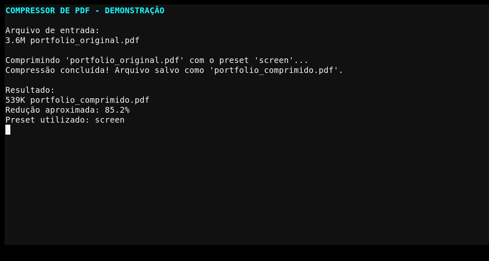

# Compressor de PDF com Python e Ghostscript

> Utilitário em Python para reduzir o tamanho de arquivos PDF usando diferentes níveis de compressão do Ghostscript.

Este projeto automatiza a compressão de PDFs por linha de comando e permite escolher o equilíbrio entre **tamanho do arquivo e qualidade visual** de acordo com o cenário de uso.

## 🎯 O problema que resolve

PDFs grandes podem dificultar:

- envio por e-mail;
- upload em sistemas com limite de tamanho;
- compartilhamento;
- armazenamento;
- publicação na web.

O script oferece uma forma simples de aplicar os presets do Ghostscript sem precisar montar manualmente todos os parâmetros de execução.

## ✨ Funcionalidades

- Compressão de arquivos PDF
- Seleção de diferentes níveis de qualidade
- Execução por terminal
- Compatibilidade com Windows, Linux e macOS, desde que o Ghostscript esteja instalado
- Tratamento de caminhos de entrada e saída
- Integração do Python com processo externo por `subprocess`

## 📸 Demonstração

### Compressão via terminal



## 🛠️ Tecnologias

- Python 3
- Ghostscript
- argparse
- subprocess
- os
- sys

## 📦 Requisito

O **Ghostscript** deve estar instalado no computador e acessível pelo sistema.

### Linux — Debian/Ubuntu

```bash
sudo apt-get install ghostscript
```

### macOS — Homebrew

```bash
brew install ghostscript
```

### Windows

Instale o Ghostscript pelo site oficial e garanta que o executável esteja disponível no `PATH` do sistema.

## 📥 Instalação do projeto

```bash
git clone https://github.com/Kennedh/Compress_pdf.git
cd Compress_pdf
```

O script utiliza módulos nativos do Python; a principal dependência externa é o Ghostscript.

## ▶️ Como usar

Sintaxe:

```bash
python compress_pdf.py ARQUIVO_ENTRADA ARQUIVO_SAIDA [-p PRESET]
```

Exemplo com o preset padrão:

```bash
python compress_pdf.py original.pdf comprimido.pdf
```

Exemplo priorizando redução de tamanho:

```bash
python compress_pdf.py original.pdf comprimido.pdf -p screen
```

Exemplo priorizando impressão:

```bash
python compress_pdf.py original.pdf comprimido.pdf -p printer
```

## ⚙️ Presets disponíveis

| Preset | Característica | Uso recomendado |
|---|---|---|
| `screen` | Maior compressão, menor resolução | Visualização em tela e anexos |
| `ebook` | Equilíbrio entre qualidade e tamanho | Uso geral e distribuição digital |
| `printer` | Maior qualidade | Impressão convencional |
| `prepress` | Maior fidelidade | Fluxos de impressão profissional |

O preset padrão é `ebook`.

## 🧠 Como funciona

O Python recebe os argumentos informados pelo usuário e monta a execução do Ghostscript por meio de `subprocess`.

Dessa forma, o projeto funciona como uma camada de automação: o usuário fornece o PDF, escolhe o perfil de compressão e recebe um novo arquivo de saída.

## 💡 O que este projeto demonstra

- Automação de tarefas com Python
- Integração com programas externos
- Uso de argumentos de linha de comando
- Manipulação de caminhos e arquivos
- Criação de utilitários para problemas reais

## 🚀 Possíveis evoluções

- Interface gráfica
- Processamento de vários PDFs em lote
- Comparação automática do tamanho antes e depois
- Validação mais detalhada do PDF de entrada
- Presets personalizados
- Empacotamento como executável

---

Desenvolvido por [Kennedh](https://github.com/Kennedh).
